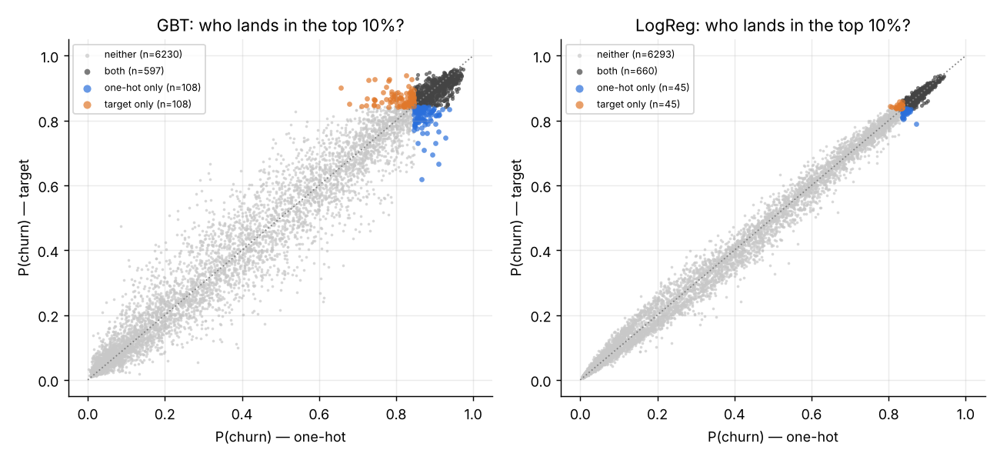
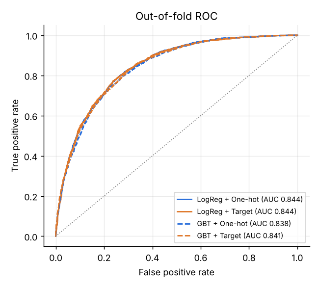
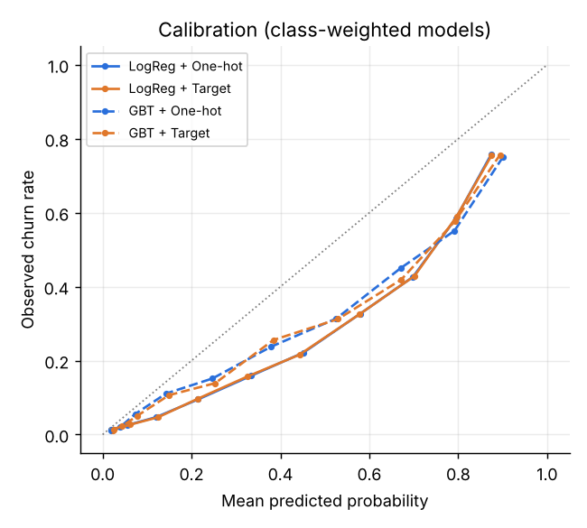
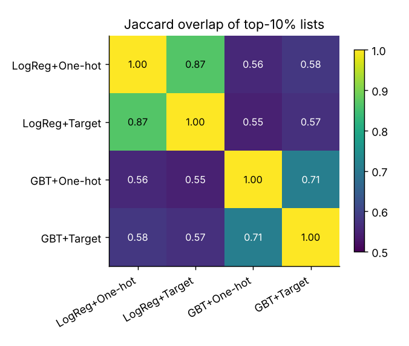
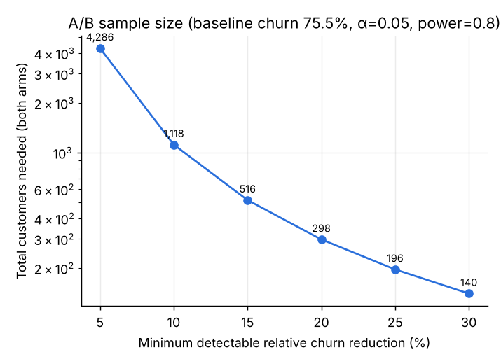

# Categorical Encoding Choices and Their Impact on Churn Targeting

[](https://github.com/jingyi21-77/churn-encoding-study/actions)


Code and results for the paper **"Categorical Encoding Choices and Their Impact on Churn
Targeting: Evidence on Telco Data with an A/B Test Design Plan"** (Jingyi Yang).

> **TL;DR** — On the IBM Telco churn data, swapping one-hot for target encoding barely moves
> AUC (+0.0035 for gradient boosting, 0.0000 for logistic regression), **but it changes who
> gets targeted**: about 17% of the GBT top-10% risk list (7% for LogReg) is replaced. Encoding is
> not a neutral preprocessing step — it is part of the targeting decision.

<p align="center">
  
</p>

---

## Research questions

| | Question | Where in code |
|---|---|---|
| **RQ1** | How do one-hot and target encoding affect AUC / F1 for L2 logistic regression and gradient-boosted trees? | `cv.py`, `metrics.py` |
| **RQ2** | Do different encodings change *who* is targeted (Spearman of risk scores, Jaccard of top-10% lists)? | `stability.py` |
| **RQ3** | What A/B test (metrics, sample size, guardrails) should validate a retention offer? | `abtest.py` |

## Quick start

```bash
git clone https://github.com/jingyi21-77/churn-encoding-study.git
cd churn-encoding-study
pip install -r requirements.txt pytest

make test        # 11 unit tests, incl. a target-encoding leakage test (~3 s)
make quick       # smoke run: 1 seed, tiny grid (~20 s)
make reproduce   # full study behind the numbers below (~11 min on a laptop CPU)
```

All outputs land in `results/` (`summary.md`, CSVs, figures). Every setting lives in
[`configs/default.yaml`](configs/default.yaml).

## Method (paper §3)

* **Data** — IBM Telco Customer Churn, 7,043 customers, 26.5% churn. 3 numeric +
  16 categorical features. Blank `TotalCharges` (tenure 0) → 0.
* **Imbalance** — class weights (`class_weight="balanced"` / balanced `sample_weight`), no resampling.
* **Encoders (the treatment)** — `OneHotEncoder` (46 features) vs `TargetEncoder` with
  empirical-Bayes smoothing (19 features). Everything else in the pipeline is identical.
* **Leakage control** — target statistics are fitted **only on the training folds**, using
  internal cross-fitting so training rows never see their own label. Validation/test rows are
  encoded with statistics that never saw their labels. A unit test checks that on random
  labels with a near-unique category, held-out AUC stays ≈ 0.5.
* **Protocol** — stratified 5-fold; each iteration uses **3 folds train / 1 val / 1 test**.
  The val fold picks hyper-parameters, the GBT early-stopping point (min val log-loss) and the
  F1-optimal threshold. Repeated for 3 seeds → 15 test folds per cell, and one out-of-fold
  risk score per customer.
* **Models** — L2 logistic regression (C ∈ {0.01, 0.1, 1, 10}); gradient-boosted trees
  (depth ∈ {2,3,4}, lr ∈ {0.05, 0.1}, subsample 0.8, ≤500 trees, early-stopped).

## Results

### RQ1 — Predictive performance (mean ± sd, 15 test folds)

| Model | Encoder | AUC | F1 | Precision | Recall | Brier |
|---|---|---|---|---|---|---|
| LogReg | One-hot | 0.8438 ± 0.012 | 0.6251 ± 0.019 | 0.555 | 0.724 | 0.1658 |
| LogReg | Target  | 0.8439 ± 0.012 | 0.6245 ± 0.019 | 0.555 | 0.725 | 0.1655 |
| GBT    | One-hot | 0.8394 ± 0.015 | 0.6221 ± 0.020 | 0.543 | 0.734 | 0.1582 |
| GBT    | Target  | **0.8430 ± 0.013** | 0.6215 ± 0.022 | 0.555 | 0.714 | 0.1580 |

Paired on identical folds, target encoding improves GBT AUC by **+0.0035** (better in 12/15
folds, paired-t p = 0.008) and leaves logistic regression unchanged (p = 0.91). F1 and Brier
differences are negligible. This matches the paper's prior expectation: target encoding helps
tree models a little, because one split on a target-encoded column can separate several
categories at once.

<p align="center">
  
  
</p>

### RQ2 — Targeting stability (top 10% = 705 customers)

| Comparison | Spearman ρ | Jaccard (top 10%) | Share of list kept |
|---|---|---|---|
| LogReg: one-hot vs target | 0.994 | 0.867 | 92.9% |
| GBT: one-hot vs target    | 0.974 | **0.714** | **83.3%** |
| LogReg vs GBT (same encoder) | 0.94–0.95 | 0.55–0.58 | 71–74% |

<p align="center"></p>

* Rank correlations are very high (ρ > 0.97). Even so, the **top-decile lists differ**: under GBT,
  108 of 705 targeted customers (~15%) change when only the encoder changes.
* Customers that only **one-hot GBT** targets have longer tenure (10.7 vs 7.6 months) and lower
  charges than those only **target GBT** targets (`results/segment_profile.csv`). All
  targeted customers are on month-to-month contracts under every configuration.
* **Context from a noise baseline.** Re-running the *same* encoder + model on a different CV
  split gives Jaccard ≈ 0.60–0.64 for GBT and ≈ 0.80 for LogReg (`stability_seed_noise.csv`).
  So the encoder effect is similar in size to ordinary retraining variability. **The
  model-family choice moves the list most (Jaccard ≈ 0.56).** A churn-targeting list built on a
  boundary at the 10th percentile is fragile, and encoding is one of several design choices
  that move it.

### RQ3 — A/B test blueprint (paper §5)

1. **Population** — top 10% risk under the best-AUC configuration (LogReg + target).
2. **Randomization** — 1:1 to *retention offer* vs *no offer* within that pool.
3. **Primary metric** — 30-day churn rate; two-sided two-proportion z-test, α = 0.05, power 0.8.
4. **Guardrails** — ARPU, refund rate, complaint rate; non-inferiority check
   (`abtest.guardrail_check`, e.g. revenue may not drop > 5%).
5. **Stopping** — fixed horizon, early stop only for large harm on guardrails.

Using the observed churn rate of the eligible pool as baseline (75.5%):

| Relative MDE | Absolute MDE | n per arm | Total | Months to enroll* |
|---|---|---|---|---|
| 5%  | 3.8 pp  | 2,143 | 4,286 | 6.1 |
| 10% | 7.5 pp  | 559 | 1,118 | 1.6 |
| 20% | 15.1 pp | 149 | 298 | 0.4 |
| 30% | 22.6 pp | 70 | 140 | 0.2 |

\*Assumes 700 newly eligible customers per month (`configs/default.yaml`). A Monte-Carlo
simulation of the 20% design gives empirical power 0.797, matching the analytic 0.80.

<p align="center"></p>

> ⚠️ The Telco label is a churn snapshot, not a true 30-day rate, so the 75% baseline is
> illustrative. Plug in your real 30-day churn rate with `abtest.sample_size_two_proportions`.

**Calibration matters for multi-tier offers.** Class weighting makes all four models
**over-predict** churn (see the calibration plot). If risk scores will set offer tiers or
expected-value thresholds (`metrics.cost_benefit_threshold`), recalibrate first (e.g. Platt
or isotonic on the validation fold). Rankings, and so top-k targeting, are not affected.

## Repository layout

```
├── configs/default.yaml          # all experiment settings
├── data/raw/                     # IBM Telco CSV (auto-downloaded if missing)
├── src/churn_encoding/
│   ├── data.py                   # load + clean            (paper §3.1)
│   ├── pipelines.py              # encoder × model pipelines (§3.1–3.2)
│   ├── cv.py                     # 3/1/1 stratified CV, tuning, early stopping (§3.2)
│   ├── metrics.py                # AUC, F1, Brier, thresholds (§3.2)
│   ├── stability.py              # Spearman, top-k Jaccard, segment profiles (§4)
│   ├── abtest.py                 # power, sample size, z-test, guardrails, simulation (§5)
│   └── plots.py
├── scripts/run_experiment.py     # end-to-end runner → results/
├── results/                      # committed outputs: summary.md, CSVs, figures
└── tests/test_core.py            # protocol, leakage, stability & power tests
```

## Limitations and extensions

A single public dataset and two model families. The A/B test is designed, not run. Natural next
steps, each a small change to `pipelines.py` / the config: more encoders (GLMM, hashing,
CatBoost ordered TS), fairness metrics on the targeted groups, and uplift models for
heterogeneous treatment effects.

## Citation

See [`CITATION.cff`](CITATION.cff). Dataset © IBM (sample data).
